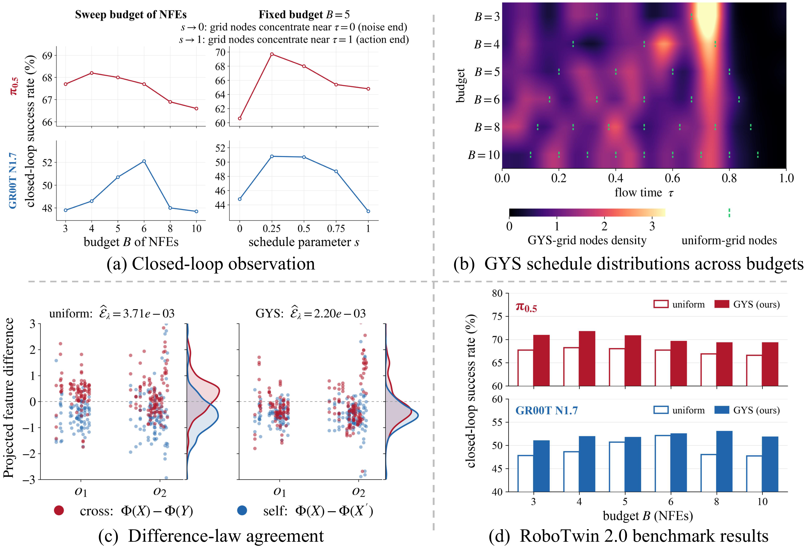

<h1 align="center">Ground Your Steps: Optimizing Sampling Schedules in Flow Matching Robot Policies</h1>

<p align="center">
  Licheng Yang<sup>1,2,3</sup>, Yonghao He<sup>2,†</sup>, Lingfeng Qian<sup>2</sup>, Xin Shi<sup>2</sup>, Wei Sui<sup>2,✉︎</sup>, Hu Su<sup>1,✉︎</sup>
</p>

<p align="center">
  <sup>1</sup> State Key Laboratory of Multimodal Artificial Intelligence Systems, Institute of Automation, Chinese&nbsp;Academy&nbsp;of&nbsp;Sciences<br>
  <sup>2</sup> D-Robotics<br>
  <sup>3</sup> School of Artificial Intelligence, University of Chinese Academy of Sciences<br>
  <sup>†</sup> Project lead &emsp; <sup>✉︎</sup> Corresponding authors
</p>

<p align="center">
  <a href="https://d-robotics-ai-lab.github.io/GroundYourSteps.project/"></a>
  
  <a href="LICENSE"></a>
</p>

## 1. Introduction

> *Flow-matching VLAs default to uniform sampling schedules, so what happens when the schedule is no longer uniform?*

<p align="center">
  
</p>

Flow-matching VLA policies generate action chunks by integrating a learned velocity field from noise to actions with only a few neural function evaluations (NFEs). Closed-loop success indeed varies non-monotonically with the NFE budget and changes with node placement at a fixed budget (a). This raises the question of how to choose the schedule so that the generated actions match the demonstrations.

**Ground Your Steps (GYS)** is a training-free method that optimizes the sampling schedule offline for each task and NFE budget. GYS minimizes the energy distance between two pairwise-difference distributions of action chunks (c), generated-demonstrated and generated-generated, each transformed by a truncated fractional-difference operator and paired with observation summaries, and delivers a non-uniform schedule (b). The two distributions coincide when the generated and demonstrated action distributions match, so the objective grounds the schedule in the demonstrations. The optimized schedule replaces the uniform grid at deployment and raises the success rate across budgets, without changing the policy weights or the inference cost (d).

## 2. Getting Started

### 2.1 Installation

```bash
git clone https://github.com/D-Robotics-AI-Lab/GroundYourSteps.git
cd GroundYourSteps
uv venv
uv pip install --python .venv/bin/python -e '.[lerobot]'
source .venv/bin/activate
```

### 2.2 Prepare Datasets and Checkpoints

Use a **LeRobot v2** dataset and a policy checkpoint fine-tuned on that dataset. The dataset directory contains `meta/info.json`, `meta/episodes.jsonl`, and per-episode Parquet files.

**Dataset.** In the [data configuration](configs/data/lerobot.yaml), set `dataset_root` to your dataset directory, then set the state and action columns and slices, camera feature names, and `action_horizon`. To exclude gripper dimensions from the offline optimization objective, set their indices in the [method configuration](configs/method.yaml) relative to the selected action slice.

**π0.5.** Set the following fields in [`configs/lerobot_pi05.yaml`](configs/lerobot_pi05.yaml).

- `openpi_root` and `checkpoint` to the policy repository and checkpoint paths. The PyTorch checkpoint contains `model.safetensors` and `assets/**/norm_stats.json`.
- `config_name` to the openpi training configuration name.
- `camera_keys` to match the policy input transforms.

**GR00T N1.7.** Set the following fields in [`configs/lerobot_groot.yaml`](configs/lerobot_groot.yaml).

- `groot_root` and `checkpoint` to the policy repository and checkpoint paths.
- `embodiment_tag` and `camera_keys` to match the policy processor.
- `arm_joints` to the number of joints per arm. State and action vectors use the order left arm, left gripper, right arm, right gripper.

## 3. Optimization

### 3.1 Inference Sampler

By default, both policies build a uniform Euler grid from the step count. Before deploying an optimized schedule, adapt the policy’s inference sampler to accept a sequence of time nodes. During sampling, evaluate the velocity at each current node and use the signed difference to the next node as the Euler step size.

### 3.2 Optimization Examples

Run `gys solve` from the repository root to optimize the Euler schedule for one task and one budget of neural function evaluations (NFEs). Pass the policy environment’s Python interpreter with `--policy-python`. GYS evaluates candidate schedules offline in that environment.

Set `openpi_root` or `groot_root` in the configuration to the policy repository path. Replace the `--policy-python` paths below with the Python interpreter in your policy environment.

`--task` names the task and replaces `{task}` in `dataset_root` when present. `--budget` sets the number of Euler steps. Use `--device` to select the policy device, `--micro-batch` to adjust memory usage, or `--run-root` to change the output directory.

#### 3.2.1 π0.5

```bash
gys solve --config configs/lerobot_pi05.yaml --task my_task --budget 8 \
  --policy-python /path/to/openpi/.venv/bin/python
```

For inference, pass `native_nodes` to the Euler loop in `sample_actions`. The nodes run from 1 (noise) to 0 (action). [openpi sampler](https://github.com/Physical-Intelligence/openpi/blob/3e0325a/src/openpi/models_pytorch/pi0_pytorch.py#L376-L423)

#### 3.2.2 GR00T N1.7

```bash
gys solve --config configs/lerobot_groot.yaml --task my_task --budget 4 \
  --policy-python /path/to/Isaac-GR00T/.venv/bin/python
```

For inference, pass `native_nodes` to the Euler loop in the GR00T action head. The nodes run from 0 (noise) to 1 (action). Use the existing mapping from time to timestep buckets for model conditioning and compute the Euler step size from the continuous nodes. [GR00T sampler](https://github.com/NVIDIA/Isaac-GR00T/blob/n1.7-release/gr00t/model/gr00t_n1d7/gr00t_n1d7.py#L332-L421)

### 3.3 Output

The example configurations write the optimized schedule to `runs/lerobot_<policy>/<task>/B<budget>/schedule.json`.

| Field | Description |
| --- | --- |
| `nodes` | Integration nodes on the canonical axis, from 0 (noise) to 1 (action) |
| `native_nodes` | The same nodes in the policy's native time convention |
| `step_widths` | Step widths on the canonical time axis |
| `wire` | `native_nodes` serialized as a comma-separated string |

## Acknowledgement

We thank the teams behind [π0.5](https://github.com/Physical-Intelligence/openpi) and [GR00T N1.7](https://github.com/NVIDIA/Isaac-GR00T/tree/n1.7-release) for releasing their models, and [RoboTwin 2.0](https://github.com/RoboTwin-Platform/RoboTwin) for the benchmark and demonstrations.

## License

This project is released under the [Apache License 2.0](LICENSE).

## Citation
